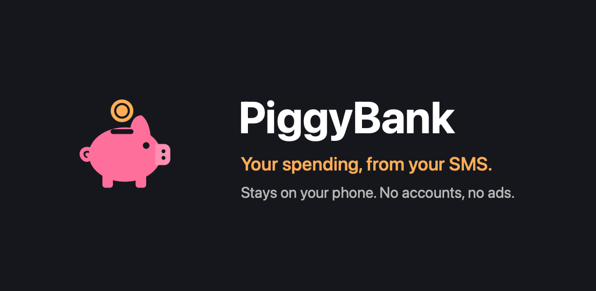
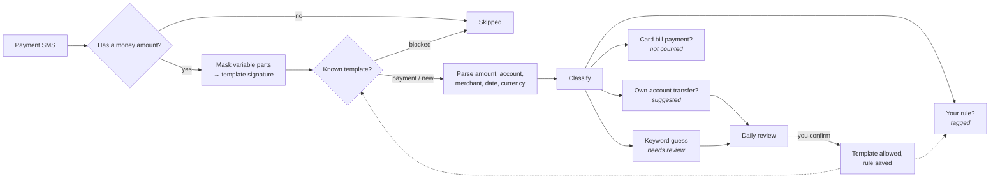

<p align="center">
  
</p>

<p align="center">
  <b>A private, offline spend tracker for Android that reads the payment SMS your bank already sends you.</b><br>
  No bank logins. No accounts. No servers. No AI reading your money.
</p>

---

## The problem

Ask most households a simple question: *how much did we actually spend this month, and where did we overspend?*
Most can't answer it.

The money is spread across several credit cards, a couple of bank accounts and a handful of UPI apps. Each has its
own statement and billing cycle. Every card has its own offers, so picking the right card for each purchase becomes a
game, and the budget quietly gets lost.

Expense trackers should fix this. In practice, the ones that read SMS tend to make the number **worse**:

| What goes wrong | Why the total is wrong |
|---|---|
| Moving money between your own accounts shows up as "spend" | The same rupee is counted when it leaves one account, and again when you spend it |
| Credit card bill payments are counted as spend | Every card purchase is counted twice: at the swipe, and again when you pay the bill |
| The bank SMS and the UPI app SMS both report one payment | One coffee becomes two |
| Merchants land in the wrong category | The "where did it go" answer can't be trusted |
| Promotional "Get ₹500 cashback" and balance alerts are read as payments | Noise inflates the total |

Most of the work in a tracker isn't the charts. It's the noise. Get the noise right and the real number shows up.

## What PiggyBank does

- **Every card, account and UPI app in one list.** It works from SMS, so any bank and any card is covered from day one, with no fixed list of supported banks.
- **The noise handled:**
  - Self-transfers between your accounts are spotted and suggested; you confirm them.
  - Card bill payments are recognised and kept out of spending, so a purchase is counted once, at the swipe.
  - Duplicate SMS for the same payment are caught.
  - OTPs, reminders, promotions and failed transactions are ignored.
- **A one-minute daily review.** Each evening you confirm the day's payments: a Need, a Want or an Investment, and a category.
- **It learns from you, not from a model.** Tag a merchant once with "Always tag like this" and every future payment to it is tagged automatically. A merchant you want to check each time (Amazon, a friend on UPI) can be set to always ask.
- **The monthly view:**
  - Income (which you enter), minus Needs and Wants, gives savings.
  - Budgets by category, with clear flags where you overspent.
  - Tap any budget to see every payment behind it.
- **Payments list.** Every tagged payment, by date or by amount, filtered by month, type and category.
- **Foreign currency.** Charges abroad keep their original amount, plus the rupee value from the SMS or a rate you enter. Rates are never fetched online.
- **Catch-up.** Import 1–12 months of SMS history, then clear the backlog quickly:
  - "Tag all identified" confirms payments PiggyBank already recognised.
  - "Tag everything under ₹X" puts small payments into one category.
- **Save where I paid (optional).** It notes your phone's location when an in-person payment SMS arrives, and shows it on a map later.
- **Backups.**
  - Every night to `Documents/PiggyBank` on the phone, kept on a rolling schedule: 7 daily, 4 weekly and 3 monthly.
  - Optionally also to your own Google Drive, in a hidden folder only the app can open.

## Design principles

### 1. Your data stays on your phone

Bank SMS is some of the most sensitive data on a phone. PiggyBank has no backend, no sign-up, no analytics, no ads and
no crash reporting. The only thing that can leave the phone is the **optional** backup to *your own* Google Drive.

This isn't just a policy; the build enforces it:

- **`verifyNetworkUse`** fails the build if any source file other than `backup/DriveClient.kt` uses a network API.
- **`verifyPermissions`** fails the build if the app, or any library it pulls in, asks for a permission that isn't on a short allowlist.
- **`allowBackup="false"`** keeps Android's own cloud backup from copying the database.

### 2. Rules where they're reliable, not guesswork

There is no machine-learning model and no LLM in the app. Every decision can be explained:

- **SMS formats are learned, not hard-coded.** Each SMS is reduced to a *signature*: the amount, account digits, dates, reference numbers and names are masked out, leaving the bank's template. When you confirm a payment, its template is marked as a payment format. When you tap "Not money", it's blocked. Before long almost every SMS matches a known template.
- **A generic parser handles new formats.** It reads any bank's wording, picking out the amount, direction, account or card, merchant or UPI ID, date and currency.
- **Categories come from your rules first.** Merchant-name keywords supply a first guess, and every guess waits for your confirmation.

### 3. You stay in control

Nothing is counted as a self-transfer, a duplicate or a category unless you've confirmed it or set a rule for it.
Every rule is listed, and any rule can be switched to "always ask" or deleted. Every tag can be changed later.

## How it works



- **New SMS** are caught the moment they arrive, even with the app closed. A catch-up scan on every app open covers anything missed while the phone was off.
- **Money is stored as whole numbers** in the currency's smallest unit (paise, cents), never as floating-point numbers.
- **Income is never read from SMS.** Credits are used only to spot your own transfers. You enter salary and other income yourself, so savings are based on what you actually earn.
- **One SQLite database** holds everything, with a versioned schema and in-place upgrades.

## Tech stack

| | |
|---|---|
| Language | Kotlin, with **Kotlin Multiplatform**: parser, rules, money maths, database and backup format live in `shared/` |
| UI | **Compose Multiplatform**, Material 3, custom icons |
| Database | **SQLDelight** (SQLite) |
| Background work | WorkManager (nightly backup), an SMS `BroadcastReceiver` |
| Drive backup | Google Identity `AuthorizationClient`, `drive.appdata` scope only, Drive REST v3 |
| Tests | 122 unit tests on the JVM: SMS parsing, classification, duplicates, budgets, backup format, database upgrades |
| CI | GitHub Actions: tests, privacy checks, then a signed APK and Play bundle on every push |

```
shared/      Shared logic and UI (Android today, iOS later)
  sms/       Generic SMS parser, template signatures, ingestion
  review/    Classifier, duplicates, review and rule learning
  month/     Budgets, income, savings, multi-currency maths
  payments/  Payments list and filters
  backup/    Backup file format and rolling retention
  place/     Optional "where I paid"
  ui/        Compose screens: Today, Review, Payments, Monthly, Settings
androidApp/  SMS receiver and inbox scan, nightly backup worker, Drive client,
             permissions, build-time privacy checks
docs/        Privacy policy, Google Play notes
```

Design and behaviour are written down before code: [PLAN.md](PLAN.md) covers the architecture and data model, and
[TEST_CASES.md](TEST_CASES.md) lists the agreed behaviour, case by case.

## Status

PiggyBank is an early personal project, used daily on one phone.

- **Android only.** iOS doesn't let apps read SMS. An iOS version would need Shortcuts-based input instead; the shared code is ready for it.
- **Tested mainly with Indian banks, cards and UPI**, with ₹ as the home currency. The parser isn't tied to a bank list, so other formats usually work after a confirmation or two.
- **Not built yet:**
  - A passphrase to encrypt the Google Drive backup.
  - An app lock.
  - A home-screen widget.
- **Not yet run end to end:** restoring from a backup. It's built, but not yet tested on a phone.

## Install

Google Play blocks sideloaded apps that read SMS on many phones, especially in India, to protect against OTP-stealing
scams. So the reliable way to install PiggyBank will be through Google Play, which is in progress.

Until then, developers can build and install it themselves:

```bash
./gradlew :androidApp:installDebug     # needs a phone connected with USB debugging on
```

## Build

You need JDK 17 and the Android SDK (platform 36, build-tools, platform-tools), installed through Android Studio or
`sdkmanager`, with `ANDROID_HOME` set or `sdk.dir` in `local.properties`.

```bash
./gradlew :shared:jvmTest                  # shared logic and database tests, no SDK needed
./gradlew :androidApp:assembleDebug        # debug APK in androidApp/build/outputs/apk/debug/
./gradlew :androidApp:check                # includes the privacy checks
```

Release builds are signed with a key kept outside the repository: locally through a git-ignored `keystore.properties`,
in CI through repository secrets. Google Play notes: [docs/PLAY_STORE.md](docs/PLAY_STORE.md).

Real SMS used for parser testing stay on the developer's machine in the git-ignored `testdata/private/`. The tests in
the repository use synthetic messages only.

## Privacy

See the [privacy policy](docs/privacy-policy.html). In one line: everything stays on your phone, unless you turn on
backup to your own Google Drive.

---

<sub>Built with the help of AI coding tools. No AI ever sees anyone's financial data. The app runs entirely on your phone.</sub>
